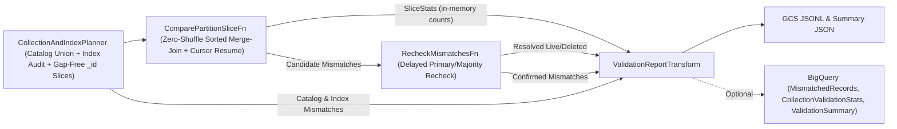

# MongoDB to Cloud Firestore Data Validator (`mongodb-data-validator`)

Batch Google Cloud Dataflow Flex Template (`Mongodb_To_Firestore_Data_Validator`) that validates collection catalogs, secondary indexes/TTLs, document counts, and deep BSON field-by-field parity between a source MongoDB cluster and a target **Cloud Firestore Enterprise Edition (MongoDB compatibility)** database.

## Architecture



### Key Design Properties

* **Zero-Shuffle Co-Partitioned Merge-Join**: Splits each collection's `_id` space by BSON type (`objectId`, `string`, `number`, `other`) into gap-free `(-inf, +inf)` ranges. Workers stream `_id`-sorted cursors from Source and Target in lockstep, counting billions of matching documents in-memory (`SliceStats`) without shuffling matched records across Dataflow workers.
* **Automatic Cursor Resume**: Reopens expired or dropped cursors (`CURSOR_NOT_FOUND` / socket resets) from `{_id: {$gt: lastCheckedId}}` without restarting the slice.
* **Live-CDC Lag Tolerance**: Candidate document discrepancies are re-fetched in byte-bounded `$in` batches after a configurable delay from Source (`readPreference=primary`, `readConcern=majority`) and Target, eliminating false positives from in-flight CDC replication lag.
* **Strict BSON Fidelity**: Preserves exact BSON types (`int32 != int64 != double` by default, with `2^53` precision-guarded `--strictTypeChecking=false` opt-in), `NaN` semantics, `Binary` subtypes (`0x03` vs `0x04` UUIDs), `Null` vs `Undefined`, `BSON Timestamp` vs `DateTime`, subdocument field order, raw wire duplicate keys, and collision-free raw BSON `_id` lookup keys.
* **Catalog, Rename & Index Parity**: Computes the union of collections across source and target (catching orphaned target collections), supports `--collectionMappings=src:tgt` and `--ignoredFields`, and audits secondary index key specs, `unique`, `sparse`, and TTL `expireAfterSeconds`.

## Build, Test & Stage

```bash
# 1. Run unit and DirectRunner pipeline tests
mvn test -pl v2/mongodb-data-validator -am -Dspotless.check.skip=true -Dcheckstyle.skip=true -Djacoco.skip=true

# 2. Build & stage the Dataflow Flex Template to GCS + Artifact Registry
mvn clean package -PtemplatesStage \
  -DskipTests \
  -DprojectId="$PROJECT_ID" \
  -DbucketName="$BUCKET_NAME" \
  -DartifactRegistry="us-central1-docker.pkg.dev/$PROJECT_ID/mongodb-data-validator" \
  -DstagePrefix="templates" \
  -DtemplateName="Mongodb_To_Firestore_Data_Validator" \
  -pl v2/mongodb-data-validator -am

# 3. Launch a validation job
gcloud dataflow flex-template run "mongo-firestore-dv-$(date +%Y%m%d-%H%M%S)" \
  --project="$PROJECT_ID" \
  --region="$REGION" \
  --template-file-gcs-location="gs://$BUCKET_NAME/templates/flex/Mongodb_To_Firestore_Data_Validator" \
  --parameters="sourceUri=$SOURCE_URI" \
  --parameters="targetUri=$FIRESTORE_MONGO_URI" \
  --parameters="sourceDatabase=prod_db" \
  --parameters="targetDatabase=prod_db" \
  --parameters="gcsOutputPath=gs://$BUCKET_NAME/dv-reports" \
  --parameters="bigQueryDataset=$PROJECT_ID.validation_reports"
```

## Outputs

### Cloud Storage (`<gcsOutputPath>/<runId>/`)
* `validation_summary.json`: Run-level status (`MATCH` / `MISMATCH`) and aggregate counts.
* `collection_stats.jsonl`: Per-collection source/target/matched/mismatched/resolved/index stats.
* `mismatches-*-of-*.jsonl`: Canonical Extended JSON `_id`s and field diffs for automated repair/replay.

### BigQuery (`--bigQueryDataset`, optional)
* `MismatchedRecords`
* `CollectionValidationStats`
* `ValidationSummary`
